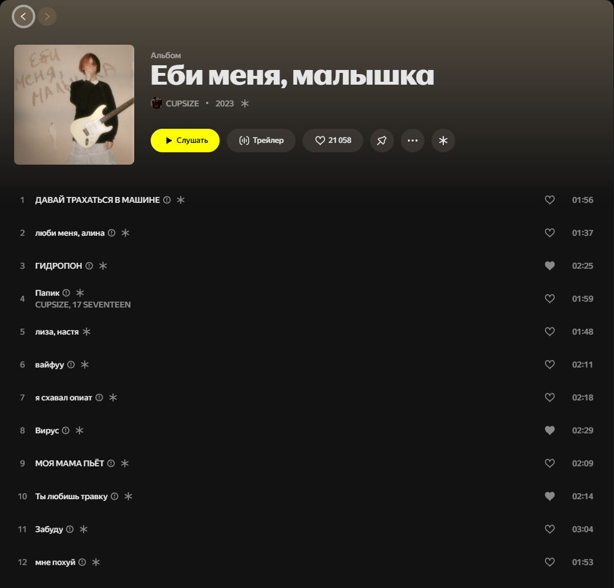
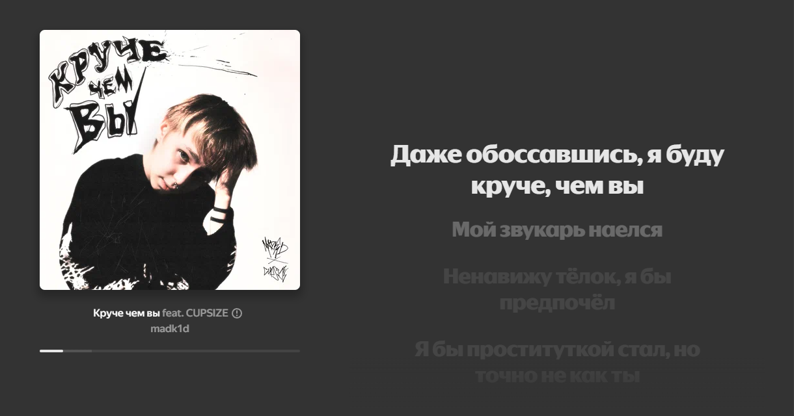
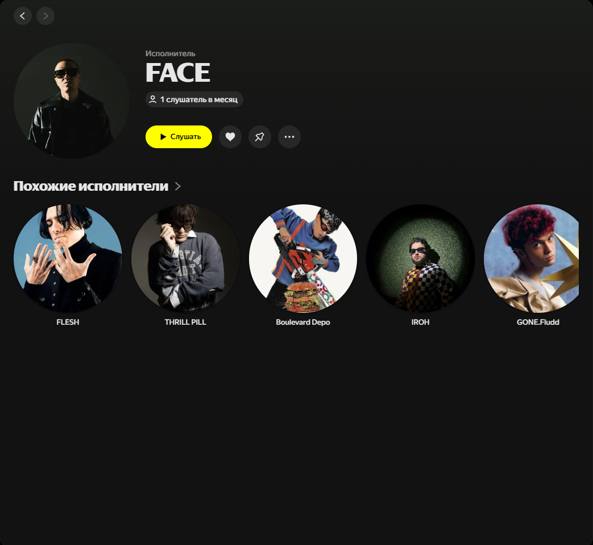

# F_ckCensor (Обход цензуры Яндекс Музыки)

[](https://github.com/S4YN3X/F_ckCensor/releases)
[](https://github.com/S4YN3X/F_ckCensor/releases/latest)
[](https://github.com/S4YN3X/F_ckCensor/releases)
[](https://github.com/S4YN3X/F_ckCensor/releases)
[](FAQ.md)

Программа для Яндекс Музыки, которая возвращает оригинальные версии зацензуренных треков, а удалённые треки и альбомы — обратно в каталог.


## Что умеет

- **Заменяет звук**: зацензуренные версии треков играют без запикивания.
- **Возвращает удалённое**: недоступные треки и даже целиком удалённые альбомы снова открываются, играют и стоят на страницах исполнителей среди остальных релизов.
- **Исправляет информацию**: названия, обложки, исполнителей и трек-листы альбомов.
- **Даёт подменить самому**: в меню «⋯» любого трека и альбома есть пункт «Подменить». Можно подставить свой аудиофайл, поменять название и обложку, собрать трек-лист альбома и добавить в него свои треки.
- **Помечает подменённое**: рядом с названием появляется значок, как у меток Яндекс Музыки.
- **Собирает плейлисты без цензуры**: кнопка со звёздочкой в «Мне нравится» и в альбомах делает плейлист с версиями без цензуры. Он хранится в вашей Яндекс Музыке и играет без цензуры даже на телефоне.
- **Принимает сообщения о цензуре**: кнопка «Сообщить о цензуре» в окне подмены отправляет трек на проверку, и после неё он подменяется у всех.
- **Ставится на паузу мгновенно**: без удаления патча и перезапуска Яндекс Музыки.
- **Обновляется сама**: при запуске проверяет новую версию, скачивает её и перезапускается.
- **Ведёт историю и статистику**: что играло, что заменено, что не загрузилось.

## Как это выглядит

<table>
  <tr>
    <th width="50%">Без F_ckCensor</th>
    <th width="50%">С F_ckCensor</th>
  </tr>
  <tr>
    <td></td>
    <td></td>
  </tr>
  <tr><td colspan="2" align="center"><i>Удалённые треки возвращаются в альбом и снова играют</i></td></tr>
  <tr>
    <td></td>
    <td></td>
  </tr>
  <tr><td colspan="2" align="center"><i>Текст песни во время прослушивания — без цензуры</i></td></tr>
  <tr>
    <td></td>
    <td></td>
  </tr>
  <tr><td colspan="2" align="center"><i>Исполнитель, у которого удалили все треки, снова с популярными треками и альбомами</i></td></tr>
</table>

## Как это работает

F_ckCensor встраивает скрипт в приложение Яндекс Музыки. Скрипт подменяет звук и данные о треках прямо внутри клиента, а сама программа живёт в трее: включает и выключает подмену, ведёт историю и следит за патчем. Подмена работает, пока F_ckCensor запущен. Если закрыть программу, Яндекс Музыка играет обычные версии треков.

Список замен загружается автоматически из [FkCensorData](https://github.com/fcensor-data/FkCensorData) (в него входит и база [FckCensorData](https://github.com/Hazzz895/FckCensorData)) и обновляется каждые 10 минут. Свои подмены хранятся только у тебя в Яндекс Музыке и на другие устройства не попадают.

## Установка

1. Скачай `F_ckCensor.exe` из [последнего релиза](https://github.com/S4YN3X/F_ckCensor/releases/latest)
2. Запусти его — откроется окно программы, а в трее появится иконка
3. На главной нажми **установить**
4. Яндекс Музыка перезапустится автоматически

F_ckCensor сам находит Яндекс Музыку в `%LOCALAPPDATA%\Programs`. Если она установлена в другое место, укажи папку в **настройках**.

Окно можно закрыть: программа продолжит работать в трее. Чтобы она запускалась вместе с Windows, включи **запуск вместе с windows** в настройках — тогда она стартует незаметно, в трее, а окно покажет только если патчу нужно внимание.

### macOS

1. Скачай `F_ckCensor-…-universal.dmg` из [последнего релиза](https://github.com/S4YN3X/F_ckCensor/releases/latest) — подходит и для Apple Silicon, и для Intel, macOS 11 и новее
2. Открой его и перетащи F_ckCensor в «Программы»
3. Программа не подписана сертификатом Apple, поэтому при первом запуске macOS её заблокирует. Выполни в Терминале:
   ```
   xattr -dr com.apple.quarantine /Applications/F_ckCensor.app
   ```
   или открой **Системные настройки → Конфиденциальность и безопасность → Всё равно открыть**
4. На главной нажми **установить**. macOS попросит разрешить F_ckCensor **управление приложениями** — разреши, иначе патч не встанет

Иконка программы появится в строке меню. Новые версии F_ckCensor ставит сам — для этого он должен лежать в «Программах». Версию 2.3.3 и старше обнови один раз вручную: скачай `.dmg` из релиза и замени приложение.

## Удаление

1. **Настройки** → **удалить патч** — Яндекс Музыка перезапустится с оригинальными файлами
2. Выключи **запуск вместе с windows** и закрой программу через меню в трее
3. Удали `F_ckCensor.exe` и папку `%LOCALAPPDATA%\F_ckCensor` с настройками и историей

## Поддерживаемые платформы

| Платформа | Статус |
|-----------|--------|
| Windows 10/11 | ✅ |
| Android, iOS | Частично* |
| macOS 11+ (Apple Silicon, Intel) | ✅ |
| Linux     | ❌ |

\* На телефоне сама программа не работает, но слушать без цензуры можно. На компьютере откройте «Мне нравится» или альбом и нажмите кнопку со звёздочкой «Собрать без цензуры». В вашей Яндекс Музыке появится плейлист с версиями без цензуры, он играет и на телефоне. Новые лайки попадают в него, когда вы снова нажмёте «Собрать» на компьютере.

## Частые вопросы

Ответы — в [FAQ.md](FAQ.md): что делать, если трек звучит с цензурой, патч слетел после обновления Яндекс Музыки или не загружаются замены, как обновить программу и что она отправляет о себе.

## Благодарности

[FckCensor](https://github.com/Hazzz895/FckCensor) и [FckCensorData](https://github.com/Hazzz895/FckCensorData) от Hazzz895 — база замен и идеи подмены треков и альбомов.

## Правообладателям

Если в базе замен есть ваше произведение и вы против — [оставьте заявку](https://fcensor-data.github.io/), его удалят из базы, как правило, в течение 3 дней.

## Дисклеймер

Проект создан в образовательных целях. Используй на свой страх и риск.

Программа не даёт пользоваться Яндекс Музыкой без подписки Яндекс Плюс.

[Лицензия](LICENSE)
